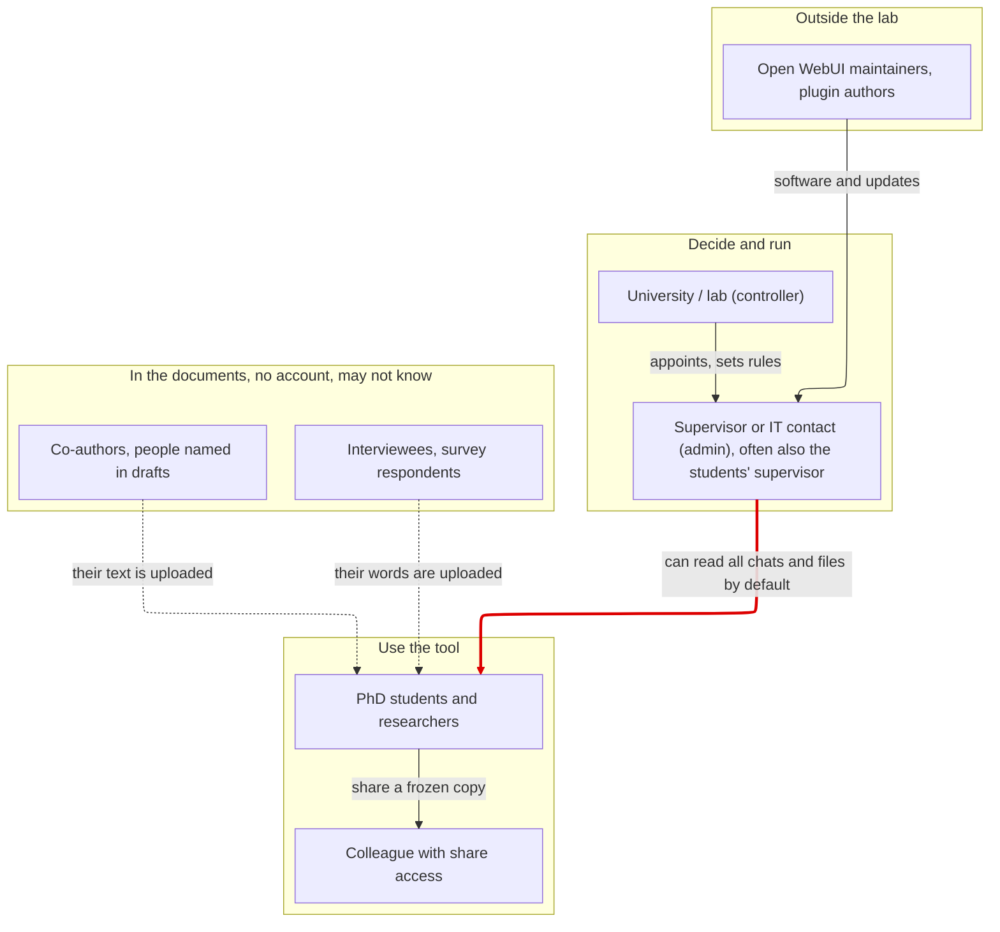
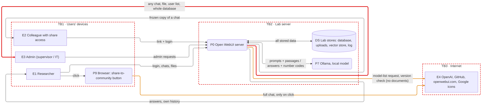
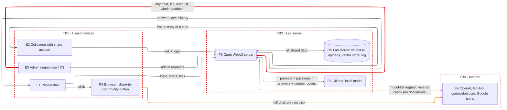
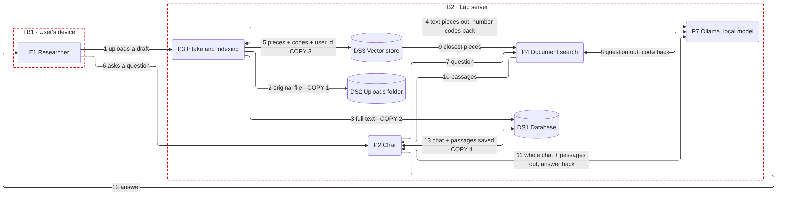
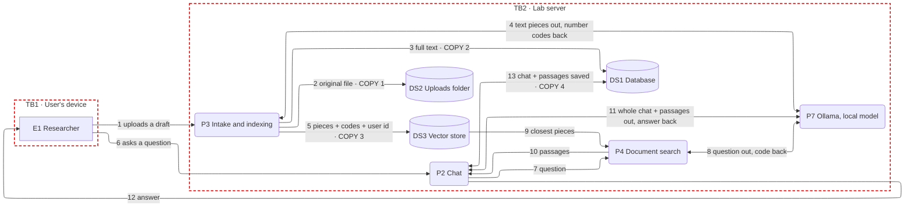
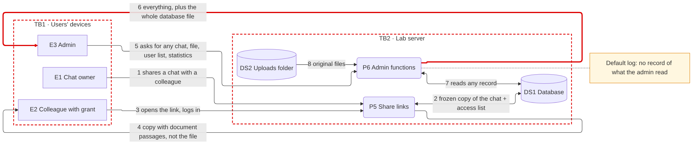
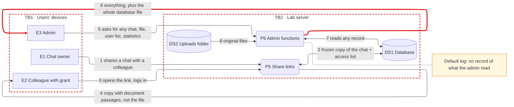
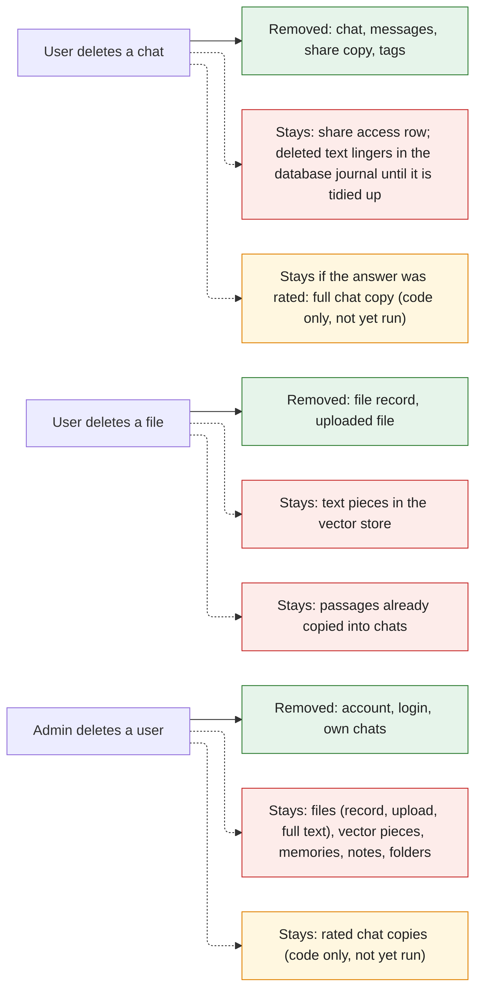
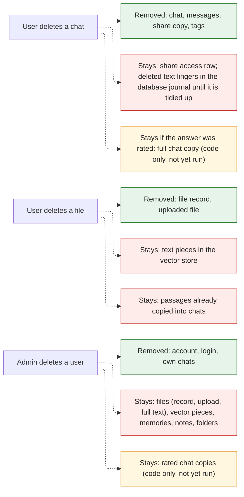

# Open WebUI — Simplified diagrams for the report

Five small views instead of one large one. Read them in order. Each has a caption that says what is VERIFIED (code line or run R##, see `data-flow-analysis.md` Appendix A) and what is not.

**Notation (course slides 45–48):** rectangle = person or outside system (E), rounded box = process (P), cylinder = data store (DS), arrow = data flow, red dashed box = trust boundary (TB1 users' devices, TB2 lab server, TB3 internet; data crossing a box edge leaves or enters the lab's control). Figures 3 and 4 are *views* of the detailed level-1 diagram (`architecture-dfd.svg`): same IDs, other elements left out on purpose. Figure 5 is a map, not a DFD.

| Figure | Answers the question | Detail lives in |
|---|---|---|
| 1 Who | Who has power over whose data? | `data-flow-analysis.md` §2 |
| 2 System | What is in the system and what leaves it? | `architecture.md` §2–3 |
| 3 Upload and ask | How many copies of a document exist? | §5.3, §5.4, §7 |
| 4 Share and admin | Who can read what, and is it recorded? | §5.5, §5.6 |
| 5 Deletion | What is left when something is deleted? | §5.7 |

## Figure 1 — Who is involved

Four groups instead of a dozen boxes. The red arrow is the power gap: the admin, who is often also the students' supervisor, can read every chat and file by default (VERIFIED, `env.py:371`, run R09). The dotted arrows show the people who are in the documents without an account.

Mermaid source

## Figure 2 — The system in one picture (context level)

One server, one local model, one group of stores, three kinds of people, and the internet. Red = admin reach. Orange = connections to the internet; the one made by the server carries no documents (VERIFIED, run R04); the one from the browser carries a full chat but only when a user clicks (VERIFIED in code, `ShareChatModal.svelte:49-70`, not run).

Mermaid source

## Figure 3 — Upload a draft, then ask a question

Shows the **four copies** of the same document text on the server: original file, full text in the database, pieces in the vector store, and passages saved inside the chat (VERIFIED, runs R06 and R07). The local model receives the text pieces and the whole chat on every turn.

Mermaid source

## Figure 4 — Sharing a chat and the admin's reach

Sharing makes a frozen copy that includes document passages but not the file (VERIFIED, run R08). The admin reads any record and downloads the whole database (VERIFIED, run R09), and by default nothing records it.

Mermaid source

## Figure 5 — What a deletion really removes (not a data-flow diagram)

Green = removed, red = stays (both seen in runs R10–R12), amber = stays according to the code but not yet run. This is the picture to open the findings with.

Mermaid source

## What was removed from the detailed diagram, and why it is safe

- P1 sign-in, P8 server-side outbound calls and the log store are merged into Figure 2. Their details stay in `architecture.md` and `data-flow-analysis.md` §5.1, §5.8, §5.9.
- Flow numbers `F1…F38` and asset IDs `A01…A10` are dropped from the pictures to keep them readable. The full level-1 diagram keeps them, so the report can cite either level.
- Nothing was deleted from the analysis itself: every flow of the detailed diagram is represented, sometimes merged with others, in at least one of Figures 2–4.
