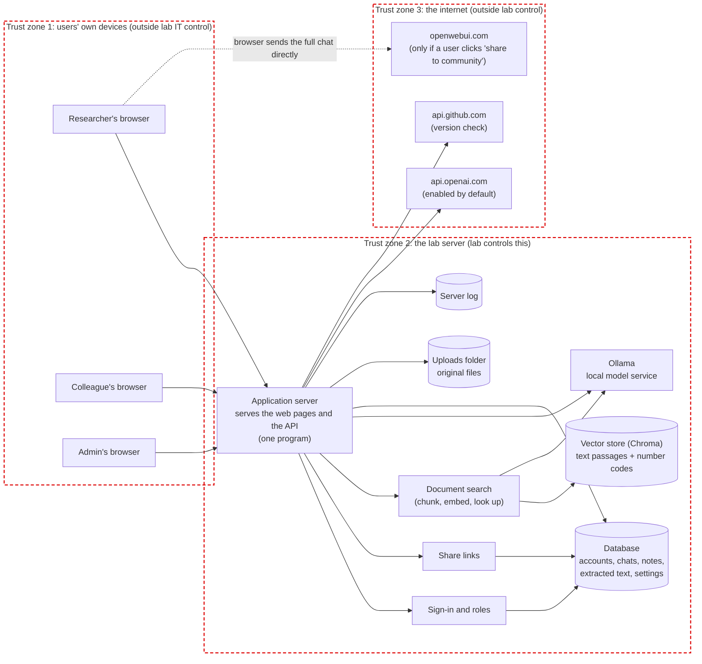
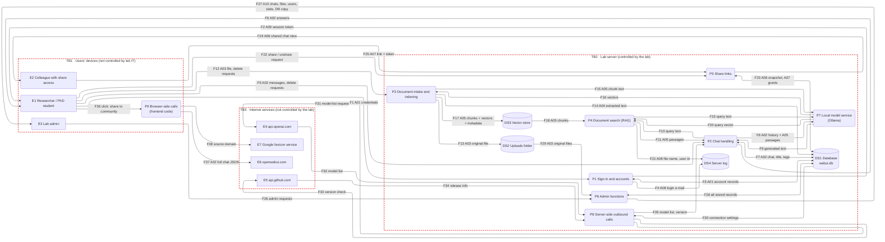

# Open WebUI — Architecture and Data-Flow Diagrams (Package 1)

> Scope: the research-lab use case only (one self-hosted instance, local Ollama, a small group of PhD students and researchers, RAG over unpublished papers and interview/survey data, share-by-link).
> Status: description only. No threat analysis and no fixes here (those come in Packages 2 and 3).
> Code version examined: Open WebUI v0.12.2, commit `6a18585ff4c2e5f6805f682222cfbc46dc669ef8`.
> Model choice is not analysed. Ollama appears only as "the local model service"; model training and memorisation are out of scope (the deployment does not train on user data).

## 0. How to read the tags

Every statement is tagged:

| Tag | Meaning |
|---|---|
| **VERIFIED (code)** `path:line` | Seen in the source code of the commit above. Paths are relative to the repository root. |
| **VERIFIED (doc)** `file:line` | Seen in the repository's own deployment files (`docker-compose.yaml`, `Dockerfile`, `backend/start.sh`). |
| **VERIFIED (run R##)** | Observed on a running instance (evidence index in `data-flow-analysis.md`, Appendix A). |
| **HYPOTHESIS** | Not seen in code or in a run. Always has a matching entry in "Open questions" in `data-flow-analysis.md`. |

Honest limits of the runtime checks: the instance was started **from source** (Docker Hub was not reachable), **API only** (the browser frontend was not built or opened), with a **stub Ollama** that records every request and an **egress proxy** that records every outbound connection and refuses it. All data was synthetic. Anything about browser behaviour is therefore code-reading only.

## 1. DFD notation used (course slides 45–48)

- External entity = rectangle (people or third-party systems). Data store = cylinder (the slides draw two parallel lines; Mermaid cannot draw open-ended stores). Process = rounded box. Data flow = solid arrow.
- Trust boundary = **red dashed box**. Meaning: everything inside is under one party's control; an arrow that crosses a box edge means data moves to or from a place the lab does not control, or controls differently.
- Consistency rules: entities and stores only talk to processes; every process has at least one flow in and one out; every store has at least one flow in and one out (unless it is only a channel to another system).
- Style tips applied: data flow, not control flow; consistent names and asset IDs; one logical actor can be two entities for two roles (here the same person can be E1 *and* E3, see the stakeholders section of `data-flow-analysis.md`).
- IDs follow slide 48: `E` entities, `P` processes, `DS` data stores, `A` assets (data types), `F` flows, `TB` trust boundaries.
- Mermaid limits: no native red dashed boundary (the subgraphs are styled red and dashed), and no open-ended store symbol.

## 2. Diagram A — Components (what the system is made of)

Plain-language view for management. Each box is a part of the installation; arrows show who talks to whom.

### Component facts

| Component | What it is | Evidence |
|---|---|---|
| Frontend | A Svelte web application, built to static files and **served by the backend itself**, same address and port. | VERIFIED (code) `backend/open_webui/main.py:3161-3168` (`SPAStaticFiles`). |
| Application server | FastAPI program started with uvicorn; listens on all interfaces (`HOST` default `0.0.0.0`), port 8080 in the container. | VERIFIED (doc) `backend/start.sh:34`, `backend/start.sh:107`; `Dockerfile:213` (`EXPOSE 8080`). |
| Deployment | Official compose file: two containers `ollama` and `open-webui`; Open WebUI data in **one** named volume mounted at `/app/backend/data`; Ollama has its own volume; host port 3000 maps to 8080 over plain HTTP; `OLLAMA_BASE_URL=http://ollama:11434`. | VERIFIED (doc) `docker-compose.yaml:2-9,11-28`, volume line 18, port line 21-22, Ollama URL line 24. |
| Database | SQLite file `DATA_DIR/webui.db`, write-ahead-log mode (so a `-wal` side file exists). Switchable to PostgreSQL by configuration. | VERIFIED (code) `backend/open_webui/env.py:228` (`DATA_DIR`), `env.py:271` (`DATABASE_URL`), `backend/open_webui/internal/db.py:383` (WAL pragma). VERIFIED (run R03). |
| Uploads folder | `DATA_DIR/uploads`, file name `{uuid}_{original name}`. | VERIFIED (code) `routers/files.py:367`, `storage/provider.py:63-69`; `config.py:156` (`STORAGE_PROVIDER=local`), `config.py:180` (`UPLOAD_DIR`). VERIFIED (run R06). |
| Vector store | Chroma in `DATA_DIR/vector_db` (default). One collection per uploaded file `file-{id}`, one per user for memories `user-memory-{uid}`. | VERIFIED (code) `config.py:509-512`; `routers/retrieval.py:1592`. VERIFIED (run R06, R12). |
| Sign-in and roles | Local accounts, bcrypt password hash, roles `admin` / `user` / `pending`; session token as HttpOnly cookie. | VERIFIED (code) `env.py:821`, `routers/auths.py:205-213`, `config.py:1748`. VERIFIED (run R01, R02). |
| Share links | A *copy* of the chat (snapshot table `shared_chat`) plus an access list; the link is an identifier, not a permission. | VERIFIED (code) `models/shared_chats.py:25`, `routers/chats.py:2049`, `routers/chats.py:114-139`. VERIFIED (run R08). |
| Ollama | Separate container in the official compose; receives prompts, text chunks to embed, and background-task prompts. | VERIFIED (doc) `docker-compose.yaml:2-9`; VERIFIED (code) `routers/ollama.py:1196` (`/api/chat`), `retrieval/utils.py:1049` (`/api/embed`). |
| Encryption in transit | The compose file exposes plain HTTP. TLS would come from a reverse proxy the lab adds. | VERIFIED (doc) `docker-compose.yaml:21-22`. Whether the lab runs a TLS proxy: **HYPOTHESIS** (Open question Q3). |
| Where Ollama physically runs | Same host as the web application is assumed. | **HYPOTHESIS** (Q4). If Ollama runs on another machine, a fourth trust zone is needed and the Ollama arrows cross it. |

## 3. Diagram B — Level-1 data-flow diagram

Scenario covered: sign-in, chat, upload of a draft, document question (RAG), sharing, admin looking around, deletion, outbound connections. Flow IDs (`F##`) are explained in the flow table below; asset IDs (`A##`) in the asset table.

**Known deviations from the slide rules (stated, not hidden):**

1. `DS4` (server log) has no outgoing flow inside the application. It is read by whoever has shell access to the host (operating system level, outside the application) — it is a channel to another system, which the rules allow.
2. `P7` Ollama is shown as one logical process although it does two jobs (text generation and embedding). One process keeps the diagram readable.
3. Deletion is shown as "delete requests" on `F5` and `F12`, and as write/delete on the arrows to the stores. The detailed behaviour (what is *actually* removed) is in `data-flow-analysis.md`, section 5.
4. `DS3` is not read by `P6` in the diagram because no admin route that reads vector content was seen. (Admin can read extracted text from `DS1` and raw files from `DS2`.) VERIFIED (run R09).
5. Browser-side storage (the session token also lives in browser `localStorage`, `src/lib/components/chat/ShareChatModal.svelte:34` reads it) is not drawn as a store; it is covered by asset `A09` on `F2`. That the frontend stores the token in `localStorage` is code-reading only.

## 4. Legend

### 4.1 External entities

| ID | Name | Role in the use case | Evidence |
|---|---|---|---|
| E1 | Researcher / PhD student | Authenticated user. Chats, uploads, shares. Also a data subject. | VERIFIED (code) `config.py:1748` (role model). |
| E2 | Colleague with share access | Authenticated user who is given access to a shared chat (the link alone is not enough). | VERIFIED (run R08). |
| E3 | Lab admin | Supervisor or IT contact. First account created becomes admin. | VERIFIED (run R01); `routers/auths.py:821-824`. |
| E4 | api.openai.com | Enabled by default with an empty key; contacted whenever the model list is built. | VERIFIED (code) `config.py:325,329`; `routers/openai.py:593-619`. VERIFIED (run R04). |
| E5 | api.github.com | Release check, when a signed-in user's browser asks `/api/version/updates`. | VERIFIED (code) `main.py:2681-2689`, `env.py:1212`. Run: not triggered in the scenario, **HYPOTHESIS** that the frontend calls it (Q8). |
| E6 | openwebui.com | Community site; receives a chat only when a user clicks the share-to-community button. | VERIFIED (code) `ShareChatModal.svelte:49-70,197-208`; `config.py:2126`. |
| E7 | Google favicon service | Receives the *domain* of a citation source, only for sources whose name starts with `http`. | VERIFIED (code) `Citations.svelte:172,188`. |

### 4.2 Processes

| ID | Name | What it does | Main code |
|---|---|---|---|
| P1 | Sign-in and accounts | Checks passwords, issues the session token, creates and lists users. | `routers/auths.py:653` (signin), `:844` (signup), `:1046` (admin add user) |
| P2 | Chat handling | Receives messages, builds prompts, stores chats, generates title/tags/follow-ups if requested. | `main.py:1146`, `utils/middleware.py:2084-2202,3944,4002,4064`, `routers/chats.py:822` |
| P3 | Document intake and indexing | Saves the file, extracts text, chunks, embeds, stores. | `routers/files.py:324-488`, `routers/retrieval.py:1366,1572` |
| P4 | Document search (RAG) | Embeds the question, looks up the closest chunks. | `retrieval/utils.py:1358`, `utils/middleware.py:2084` |
| P5 | Share links | Creates and serves snapshot copies; manages the access list. | `routers/chats.py:114-139,1276,2049,2100,2135`, `models/shared_chats.py:25` |
| P6 | Admin functions | Reads any user's chats, files, accounts; analytics; database download; deletes users. | `routers/chats.py:784,1111`, `routers/files.py:606-615`, `routers/analytics.py`, `routers/utils.py:75`, `routers/users.py:1062` |
| P7 | Local model service | Ollama: generates text and embeddings. | `routers/ollama.py:1131,1196`, `retrieval/utils.py:1031-1096` |
| P8 | Server-side outbound calls | Model list from the OpenAI-compatible endpoint; version check. | `routers/openai.py:87-129,593-619`, `main.py:2681-2689` |
| P9 | Browser-side outbound calls | Share-to-community button; favicon requests. | `ShareChatModal.svelte:42-70,197-208`, `Citations.svelte:172-188` |

### 4.3 Data stores

| ID | Store | Default location | Contents |
|---|---|---|---|
| DS1 | Database | `DATA_DIR/webui.db` (+ `-wal`, `-shm`) | Accounts (A01), chats in two tables (A02), extracted text (A04), share snapshots and grants (A06, A07), tags, notes, folders, memories, settings. |
| DS2 | Uploads folder | `DATA_DIR/uploads` | Original files (A03). |
| DS3 | Vector store | `DATA_DIR/vector_db` | Text chunks, vectors, metadata (A05). |
| DS4 | Server log | process standard output (and an optional audit file) | Login e-mail, file names, user ids (A08). |

### 4.4 Assets (data types)

| ID | Asset | Personal data? |
|---|---|---|
| A01 | Account details: name, e-mail, password hash, role, profile fields | Yes (identity) |
| A02 | Chat content: prompts, answers, title, tags, retrieved passages kept with the chat | Yes (may contain third-party data) |
| A03 | Original uploaded file | Yes when it contains interviews/surveys; confidential research otherwise |
| A04 | Extracted text of the file (full text in the database) | Same as A03 |
| A05 | Text chunks, vectors (embeddings) and chunk metadata in the vector store | Same as A03 |
| A06 | Shared-chat snapshot (full chat copy) | Same as A02 |
| A07 | Share access list and link identifier | Yes (who may read what) |
| A08 | Log entries | Yes (e-mail, user id, file name) |
| A09 | Session token (cookie and browser storage) | Yes (grants access to an account) |
| A10 | Admin exports and statistics (all chats, user list with usage, raw database file) | Yes (everything above, in bulk) |

### 4.5 Trust boundaries

| ID | Inside it | Assumption |
|---|---|---|
| TB1 | The users' own devices and browsers | Not managed by the lab. Shared or private machines, browser extensions and local storage are outside lab control. (HYPOTHESIS, Q10) |
| TB2 | The lab server, its disk volumes and the Ollama container | Managed by the lab. Physical access, operating-system accounts and backups are assumed to be controlled by the lab's IT contact. (HYPOTHESIS, Q4, Q5) |
| TB3 | Internet services | Operated by third parties; the lab has no control over what they log. |

Crossing rule: an arrow that crosses a boundary is data leaving or entering lab control. Crossings in this diagram: F1, F2, F5, F6, F12, F22, F24, F25, F26, F27 (users to server, over the lab's network; transport security is Q3), F31–F35 (server to internet), F36–F38 (browser to internet).

## 5. Flow table (what each `F##` carries)

| Flow | From → To | Data | Evidence |
|---|---|---|---|
| F1 | E1 → P1 | e-mail, password | VERIFIED (code) `routers/auths.py:653` |
| F2 | P1 → E1 | session token (cookie HttpOnly, SameSite=lax, 28 days, no Secure flag; also returned in the response body, `routers/auths.py:218`, which the frontend keeps in browser storage) | VERIFIED (code) `routers/auths.py:205-218`, `env.py:777-785`, `config.py:2531`; VERIFIED (run R02) |
| F3 | P1 ↔ DS1 | account rows and password hash | VERIFIED (code) `models/users.py:142`, `models/auths.py:27` |
| F4 | P1 → DS4 | login e-mail in a log line | VERIFIED (code) `models/auths.py:336`; VERIFIED (run R14) |
| F5 | E1 → P2 | chat messages; chat delete requests | VERIFIED (code) `main.py:1146`, `routers/chats.py:1658` |
| F6 | P2 → E1 | streamed answer, title, tags, follow-ups | VERIFIED (code) `utils/middleware.py:3944,4002,4064` |
| F7 | P2 ↔ DS1 | chat JSON, per-message rows, title, tags | VERIFIED (code) `models/chats.py:131-142`, `models/chat_messages.py:130-151`; VERIFIED (run R07) |
| F8 | P2 → P7 | full chat history plus retrieved passages; background-task prompts | VERIFIED (code) `routers/ollama.py:1196`; VERIFIED (run R07) |
| F9 | P7 → P2 | generated text | VERIFIED (run R07) |
| F10/F11 | P2 ↔ P4 | search query; retrieved passages | VERIFIED (code) `utils/middleware.py:2084-2202` |
| F12 | E1 → P3 | file bytes; file delete requests | VERIFIED (code) `routers/files.py:324,1024` |
| F13 | P3 → DS2 | original file as `{uuid}_{name}` | VERIFIED (code) `routers/files.py:367,375`; VERIFIED (run R06) |
| F14 | P3 → DS1 | full extracted text (`file.data.content`) | VERIFIED (code) `routers/retrieval.py:1709-1711`; VERIFIED (run R06) |
| F15/F16 | P3 ↔ P7 | chunk text out, vectors back | VERIFIED (code) `retrieval/utils.py:1031-1096`; VERIFIED (run R06) |
| F17 | P3 → DS3 | chunks, vectors, metadata (user id, file name, embedding config) | VERIFIED (code) `routers/retrieval.py:1549,1617`; VERIFIED (run R06) |
| F18–F20 | DS3 → P4, P4 ↔ P7 | chunks; query out, vector back | VERIFIED (code) `retrieval/utils.py:1358`; VERIFIED (run R07) |
| F21 | P4 → DS4 | log of retrieval result metadata (file name, user id, no chunk text) | VERIFIED (code) `retrieval/utils.py:337`; VERIFIED (run R14) |
| F22 | E1 → P5 | create / delete / change access of a share | VERIFIED (code) `routers/chats.py:2049,2100,2135` |
| F23 | P5 ↔ DS1 | snapshot copy of the chat; access list | VERIFIED (code) `models/shared_chats.py:25-90`, `models/access_grants.py:25` ; VERIFIED (run R08) |
| F24/F25 | P5 ↔ E2 | shared view out; link and login in | VERIFIED (code) `routers/chats.py:114-139,1276`; VERIFIED (run R08) |
| F26/F27 | E3 ↔ P6 | admin requests and results | VERIFIED (code) `routers/chats.py:784,1111`, `routers/utils.py:75`; VERIFIED (run R09) |
| F28 | P6 ↔ DS1 | reads of any record; user deletion | VERIFIED (code) `models/users.py:849-863`; VERIFIED (run R09, R12) |
| F29 | DS2 → P6 | original files, read on admin request | VERIFIED (code) `routers/files.py:606-615`; VERIFIED (run R09) |
| F30–F35 | DS1/P8/E4/E5 | OpenAI-compatible URL and key settings; `GET {url}/models`; GitHub release check | VERIFIED (code) `routers/openai.py:87-129,593-619`, `main.py:2689`; VERIFIED (run R04) for E4 |
| F36–F38 | E1/P9/E6/E7 | click; full chat JSON to openwebui.com; domain to Google | VERIFIED (code) `ShareChatModal.svelte:49-70,197-208`, `Citations.svelte:172-188`. Not executed (frontend not run). |

## 6. Rendered files

- `pia/architecture-components.png` / `.pdf` / `.svg` — Diagram A.
- `pia/architecture-dfd.png` / `.pdf` / `.svg` — Diagram B (uses the ELK layout engine; if your Mermaid viewer ignores the `layout: elk` header the diagram still renders, only more cluttered. The PNG and PDF are the reference copies).
- Sources: `pia/diagrams/components.mmd`, `pia/diagrams/dfd.mmd` (the same Mermaid text as above). Regenerate with `mmdc -i <file>.mmd -o <file>.svg` (Chromium must be reachable by Puppeteer; see `pia/verification/README.md`).
